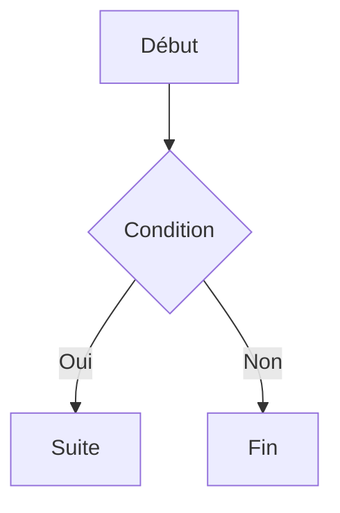

# MD2PDF

Extension Visual Studio Code qui transforme le fichier Markdown (`.md`) en
cours de lecture en document PDF, à travers un système de **modèles HTML**
personnalisables, avec rendu des diagrammes **Mermaid.js** et une pagination
(marges, en-têtes, pieds de page) pilotée entièrement en **CSS** grâce à
**Paged.js**.

## Sommaire

- [Fonctionnalités](#fonctionnalités)
- [Déclenchement de la conversion](#déclenchement-de-la-conversion)
- [Processus de transformation](#processus-de-transformation)
- [Front matter supporté](#front-matter-supporté)
- [Système de modèles](#système-de-modèles)
- [Référence des balises du moteur de modèle](#référence-des-balises-du-moteur-de-modèle)
- [Mise en page, en-têtes et pieds de page (CSS @page + Paged.js)](#mise-en-page-en-têtes-et-pieds-de-page-css-page--pagedjs)
- [Diagrammes Mermaid](#diagrammes-mermaid)
- [Formules mathématiques (LaTeX / KaTeX)](#formules-mathématiques-latex--katex)
- [Paramètres de configuration](#paramètres-de-configuration)
- [Exemples fournis](#exemples-fournis)
- [Installation et développement](#installation-et-développement)
- [Limitations connues](#limitations-connues)
- [Dépannage](#dépannage)

## Fonctionnalités

- Commande de conversion `.md` → `.pdf`, accessible via :
  - la **palette de commandes** (`MD2PDF : Convertir en PDF`) ;
  - un **raccourci clavier** : `Ctrl+Alt+P` (`Cmd+Alt+P` sur macOS) ;
  - un **bouton dans la barre d'outils** de l'éditeur (icône PDF), visible
    quand un fichier Markdown est ouvert ;
  - le **menu contextuel** de l'explorateur de fichiers.
- **Front matter** (en-tête YAML) lu automatiquement pour alimenter le modèle
  (titre, auteur, date, modèle à utiliser, etc.).
- **Modèles HTML** avec un jeu de balises simple (`{{titre}}`, `{{{content}}}`,
  conditions, boucles) et possibilité de définir des **modèles personnalisés
  par projet** (dans `.md2pdf/templates/`), prioritaires sur les
  modèles fournis par l'extension.
- **Diagrammes Mermaid.js** (` ```mermaid `) rendus en SVG directement dans le PDF.
- **Formules mathématiques LaTeX** entre `$...$` (en ligne) ou `$$...$$`
  (bloc), rendues par [KaTeX](https://katex.org/).
- **Pagination CSS** via [Paged.js](https://pagedjs.org/) : tailles de page,
  marges, en-têtes/pieds de page dynamiques (titre courant, numérotation
  "Page X / Y"), pages de garde sans en-tête/pied de page, etc. — tout est
  défini en CSS (`@page`, `@top-center`, `@bottom-right`, `string-set`…),
  sans aucun code à écrire.

## Déclenchement de la conversion

| Méthode                     | Détail                                                              |
|------------------------------|----------------------------------------------------------------------|
| Palette de commandes          | `Ctrl+Shift+P` → `MD2PDF : Convertir en PDF`                    |
| Raccourci clavier             | `Ctrl+Alt+P` (`Cmd+Alt+P` sur macOS), actif quand un `.md` est ouvert |
| Bouton barre d'outils          | Icône PDF en haut à droite de l'éditeur, sur un fichier `.md`         |
| Menu contextuel (explorateur) | Clic droit sur un fichier `.md` → `MD2PDF : Convertir en PDF`   |

Si le fichier contient des modifications non enregistrées, l'extension
propose de l'enregistrer avant de lancer la conversion.

## Processus de transformation

L'extension suit exactement le pipeline suivant (voir `src/converter.ts`) :

1. **Récupération du front matter** en entête du fichier `.md` (via
   `gray-matter`) : `title`, `author`, `date`, `template`, et tout champ
   personnalisé additionnel.
2. **Résolution du modèle** à utiliser :
   1. le modèle indiqué par le champ `template` du front matter, recherché
      d'abord dans le workspace (`.md2pdf/templates/<nom>/`) ;
   2. sinon un modèle du même nom fourni par l'extension
      (`templates/<nom>/`) ;
   3. sinon le modèle `default` fourni par l'extension.
3. **Génération du document HTML** :
   - le contenu Markdown (hors front matter) est converti en HTML
     (`markdown-it`) ; les blocs ` ```mermaid ` sont transformés en
     `<div class="mermaid">…</div>` ;
   - les données du front matter et le HTML du contenu sont injectés dans le
     modèle HTML via le moteur de balises ;
   - le document est assemblé avec le CSS du modèle, le script Mermaid.js
     (si des diagrammes sont présents) et le script Paged.js.
4. **Transformation en PDF par « impression »** : le HTML généré est chargé
   dans un navigateur Chromium headless (Puppeteer) ; Paged.js pagine le
   document selon les règles `@page` du CSS (marges, en-têtes, pieds de
   page) ; Chromium imprime ensuite ce résultat en PDF
   (`page.pdf({ preferCSSPageSize: true, ... })`), en respectant fidèlement
   la mise en page CSS.

## Front matter supporté

Champs reconnus nativement par les modèles fournis (tout champ
supplémentaire est disponible dans le modèle sous `{{monChamp}}`) :

```yaml
---
title: "Titre du document"
subtitle: "Sous-titre optionnel"
author: "Nom de l'auteur"
date: "05/07/2026"
version: "1.0"        # utilisé par le modèle "rapport"
logo: "./logo.png"    # utilisé par le modèle "rapport" (chemin relatif au .md)
template: "rapport"   # nom du modèle à utiliser ; "default" si absent
---
```

## Système de modèles

Un modèle est un dossier contenant :

```
mon-modele/
├── template.html   # fragment HTML injecté dans le <body> du document
└── style.css       # CSS complet, y compris les règles @page
```

Deux modèles sont fournis :

- **`default`** : mise en page simple (titre, auteur/date, contenu, pied de
  page), en-tête de page reprenant le titre, pied de page avec numérotation.
- **`rapport`** : page de garde plein format (dégradé de couleur, logo,
  titre, sous-titre, métadonnées), suivie de pages de contenu avec en-tête
  « titre à gauche / section courante à droite » et numérotation au centre
  du pied de page.

### Définir un modèle personnalisé dans un projet

Dans la racine du workspace :

```
mon-projet/
├── .md2pdf/
│   └── templates/
│       └── compact/
│           ├── template.html
│           └── style.css
└── notes/
    └── note.md         # front matter : template: "compact"
```

Voir l'exemple complet dans `examples/workspace-demo/`.

## Référence des balises du moteur de modèle

Le moteur de modèle (`src/templateEngine.ts`) est volontairement minimaliste
(pas de dépendance à un moteur de templating tiers) :

| Balise                          | Effet                                                                 |
|-----------------------------------|--------------------------------------------------------------------|
| `{{champ}}`                      | Insère la valeur du champ, **échappée** (texte)                     |
| `{{{champ}}}`                    | Insère la valeur **sans échappement** (HTML brut — utilisé pour `content`) |
| `{{#si champ}} ... {{/si}}`       | Affiche le bloc uniquement si `champ` est défini et non vide          |
| `{{#chacun champ}} {{.}} {{/chacun}}` | Répète le bloc pour chaque élément d'un tableau `champ`, `{{.}}` = élément courant |
| `{{champ.sousChamp}}`            | Accès à une valeur imbriquée (notation pointée)                       |

Champs toujours disponibles en plus du front matter :

| Champ               | Contenu                                                        |
|----------------------|-----------------------------------------------------------------|
| `content`            | HTML généré à partir du corps Markdown (utiliser `{{{content}}}`) |
| `sourceFileName`     | Nom du fichier `.md` (sans extension)                            |
| `generatedDate`      | Date de génération (format `fr-FR`)                              |
| `generatedDateTime`  | Date et heure de génération (format `fr-FR`)                     |

## Mise en page, en-têtes et pieds de page (CSS `@page` + Paged.js)

Tout se pilote dans `style.css` du modèle, avec la syntaxe standard
[CSS Paged Media](https://www.w3.org/TR/css-page-3/), interprétée par
Paged.js au moment de la génération :

```css
@page {
  size: A4;
  margin: 30mm 20mm 25mm 20mm;

  @top-center {
    content: string(doc-title); /* en-tête = titre courant */
  }
  @bottom-center {
    content: "Page " counter(page) " / " counter(pages);
  }
}

/* Capture le texte du titre pour l'en-tête ci-dessus */
.doc-title {
  string-set: doc-title content();
}
```

Pour une **page de garde sans en-tête/pied de page**, utiliser une page
nommée (voir le modèle `rapport`) :

```css
@page cover {
  size: A4;
  margin: 0;
}
.cover-page {
  page: cover;      /* associe cet élément à la page nommée "cover" */
  break-after: page;
}
```

### Insérer un champ du front matter dans l'en-tête ou le pied de page

Le CSS d'un modèle passe lui aussi par le moteur de balises (comme le
`template.html`), avec un échappement adapté au CSS. Cela permet d'insérer
**directement** une valeur du front matter dans une règle `@page`, sans
passer par `string-set` :

```yaml
---
title: "Mon document"
author: "Alice Martin"
version: "1.2"
---
```

```css
@page {
  @bottom-left {
    content: "{{author}}";               /* -> "Alice Martin" */
  }
  @bottom-right {
    content: "{{#si version}}v{{version}}{{/si}}"; /* -> "v1.2", ou vide si absent */
  }
}
```

Les mêmes balises que dans `template.html` sont disponibles :
`{{champ}}` (échappé pour le CSS), `{{#si champ}}…{{/si}}`,
`{{#chacun champ}}…{{/chacun}}`.

**Différence avec `string-set`** : une valeur de front matter (auteur,
version, date…) est **constante sur tout le document** — `{{champ}}` dans le
CSS suffit. `string-set`/`string()` sert au contraire à afficher un texte
qui **change en fonction de la page** (ex : le titre de la section en cours
sur la page affichée), car il capture le contenu d'un élément HTML au fil du
document — un cas que le front matter, statique, ne peut pas couvrir.

## Diagrammes Mermaid

Tout bloc de code avec le langage `mermaid` est automatiquement détecté et
rendu :

````markdown

````

Le thème utilisé est configurable via `md2pdf.mermaidTheme`
(`default`, `neutral`, `dark`, `forest`, `base`).

## Formules mathématiques (LaTeX / KaTeX)

Les formules LaTeX entre `$...$` (en ligne) ou `$$...$$` (en bloc) sont
automatiquement détectées et rendues par [KaTeX](https://katex.org/) :

```markdown
L'identité d'Euler : $e^{i\pi}+1=0$.

$$
\int_{-\infty}^{\infty} e^{-x^2} \, dx = \sqrt{\pi}
$$
```

Le rendu se fait **côté serveur** (dans l'extension elle-même, avant même
l'ouverture de Chromium) : contrairement à Mermaid, KaTeX n'a pas besoin
d'un navigateur pour produire le HTML final de la formule. La feuille de
style KaTeX (polices comprises) n'est chargée que si le document contient
au moins une formule, pour ne pas alourdir inutilement les documents qui
n'en utilisent pas.

Une formule mal formée n'interrompt pas la conversion : elle est affichée
en rouge à l'endroit où elle apparaît (comportement `throwOnError: false`),
pour rester visible et facile à corriger sans relancer toute la génération.

Les délimiteurs `\(...\)` / `\[...\]` (notation LaTeX "brackets") ne sont
pas activés par défaut — seuls `$...$` et `$$...$$` le sont — pour éviter
toute confusion avec des parenthèses ou crochets Markdown ordinaires.

## Paramètres de configuration

| Paramètre                              | Défaut                        | Description                                                                 |
|------------------------------------------|--------------------------------|-------------------------------------------------------------------------------|
| `md2pdf.defaultTemplate`            | `"default"`                    | Modèle utilisé si le front matter ne précise pas `template`                  |
| `md2pdf.templatesFolder`            | `".md2pdf/templates"`    | Dossier (relatif au workspace) des modèles personnalisés                     |
| `md2pdf.outputFolder`               | `""`                           | Dossier de sortie du PDF (vide = même dossier que le `.md`)                  |
| `md2pdf.keepIntermediateHtml`       | `false`                        | Conserve le HTML intermédiaire (`<fichier>.preview.html`) pour déboguer      |
| `md2pdf.mermaidTheme`               | `"default"`                    | Thème des diagrammes Mermaid                                                  |
| `md2pdf.openAfterExport`            | `true`                         | Ouvre automatiquement le PDF généré                                          |
| `md2pdf.chromiumExecutablePath`     | `""`                           | Chemin vers un Chrome/Chromium existant (environnements sans accès internet) |

## Exemples fournis

Dans `examples/` :

- `simple-exemple.md` — modèle `default`, tableau, citation, diagramme Mermaid.
- `rapport-exemple.md` — modèle `rapport`, page de garde, diagrammes Gantt et séquence.
- `formules-math-exemple.md` — formules LaTeX en ligne et en bloc, combinées à un diagramme Mermaid.
- `workspace-demo/note-interne.md` — utilise un modèle **personnalisé** `compact`
  défini dans `workspace-demo/.md2pdf/templates/compact/`, qui illustre
  la priorité "modèle du projet > modèle de l'extension".

## Installation et développement

```bash
npm install
npm run compile     # ou npm run watch en développement
```

Puis dans VS Code : appuyer sur **F5** pour lancer une fenêtre "Extension
Development Host" avec le dossier `examples/` ouvert, contenant les fichiers
de démonstration.

### Empaquetage

```bash
npm install -g @vscode/vsce
npm run package     # génère md2pdf-<version>.vsix
```

## Limitations connues

- La génération PDF s'appuie sur Puppeteer, qui télécharge un Chromium lors
  du premier `npm install` (environ 200–300 Mo). En environnement sans accès
  internet, configurer `md2pdf.chromiumExecutablePath` vers une
  installation de Chrome/Chromium déjà présente sur la machine.
- Les images en **chemin relatif** dans le Markdown sont résolues par
  rapport au dossier du fichier `.md` (via une balise `<base href>`). Les
  chemins **absolus** (Windows, UNC, Unix/macOS) sont aussi pris en charge,
  voir la section Dépannage ci-dessous pour la syntaxe requise.
- Les modèles ne supportent pas d'inclusions imbriquées (un modèle = un
  `template.html` + un `style.css`) ; toute logique plus avancée doit être
  exprimée en CSS (Paged Media) plutôt qu'en JavaScript côté modèle.

## Dépannage

**Une image ne s'affiche pas dans le PDF, et son texte ``
apparaît tel quel (non converti) dans le document.**

C'est une règle de la syntaxe Markdown standard (CommonMark), pas un bug de
l'extension : une destination d'image écrite entre parenthèses **ne peut
pas contenir d'espace** non échappé. C'est un cas fréquent avec les chemins
Windows absolus, souvent pleins d'espaces :

```markdown
<!-- ❌ Ne fonctionne pas : le chemin contient des espaces -->


<!-- ✅ Fonctionne : le chemin est encadré par < > -->


<!-- ✅ Fonctionne aussi, et c'est la solution la plus robuste et portable :
     un chemin relatif au fichier .md, sans espace à gérer -->

```

MD2PDF détecte automatiquement ce cas et affiche un avertissement après la
conversion, avec le détail des références concernées, pour éviter de
découvrir l'image manquante seulement à l'ouverture du PDF.

Les chemins **absolus** sont pris en charge, qu'ils soient écrits à la
Windows (`D:\Dossier\image.png`), en UNC (`\\serveur\partage\image.png`) ou
à l'Unix/macOS (`/Users/alice/image.png`) — ils sont automatiquement
convertis en URL `file://` valide. Seule la règle ci-dessus (encadrer par
`< >` si le chemin contient un espace) reste à respecter, car elle vient de
la syntaxe Markdown elle-même, pas de l'extension.

**Les bordures de tableau (ou des couleurs de fond) n'apparaissent pas dans
le PDF alors qu'elles s'affichent dans le navigateur.**

Puppeteer imprime déjà avec `printBackground: true`, mais Chromium a besoin
en complément de la propriété CSS `print-color-adjust: exact` (et son alias
`-webkit-print-color-adjust: exact`) pour rendre fidèlement les couleurs de
fond et les bordures fusionnées (`border-collapse`) à l'impression — c'est
l'équivalent CSS de l'option "Imprimer les arrière-plans" d'un dialogue
d'impression classique. Les modèles fournis (`default`, `rapport`)
l'appliquent déjà globalement :

```css
* {
  -webkit-print-color-adjust: exact;
  print-color-adjust: exact;
  color-adjust: exact;
}
```

Si tu crées un modèle personnalisé, pense à reprendre cette règle dans son
`style.css`.

**Le PDF ne se génère jamais et l'erreur `Waiting failed: ... exceeded`
apparaît.**

Vérifie que ton modèle personnalisé ne bloque pas le rendu Paged.js (par
exemple un CSS invalide dans une règle `@page`). Active
`md2pdf.keepIntermediateHtml` pour inspecter le fichier
`<fichier>.preview.html` généré et repérer un éventuel problème.
