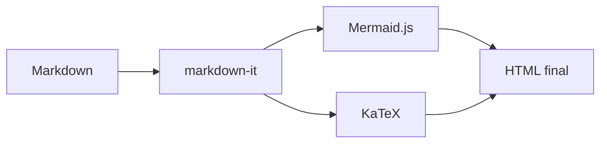

# Formules en ligne

La célèbre identité d'Euler s'écrit $e^{i\pi}+1=0$, et relie cinq constantes
fondamentales des mathématiques dans une seule équation.

La relation masse-énergie d'Einstein est $E = mc^2$, où $c$ désigne la
vitesse de la lumière dans le vide.

# Formules en bloc

L'intégrale de Gauss :

$$
\int_{-\infty}^{\infty} e^{-x^2} \, dx = \sqrt{\pi}
$$

La formule de Bayes, très utilisée en statistiques :

$$
P(A \mid B) = \frac{P(B \mid A) \, P(A)}{P(B)}
$$

Un système d'équations, à l'aide d'une matrice :

$$
\begin{pmatrix} a & b \\ c & d \end{pmatrix}
\begin{pmatrix} x \\ y \end{pmatrix}
=
\begin{pmatrix} e \\ f \end{pmatrix}
$$

# Combinaison avec un diagramme Mermaid

Le schéma ci-dessous et la formule qui suit illustrent tous deux la même
extension : les blocs ```mermaid``` sont rendus par Mermaid.js, les formules
entre `$...$` ou `$$...$$` sont rendues par KaTeX — les deux sont détectés
et injectés automatiquement, uniquement s'ils sont utilisés dans le document.



La variance d'une variable aléatoire discrète :

$$
\mathrm{Var}(X) = \sum_{i=1}^{n} p_i \, (x_i - \mu)^2
$$
