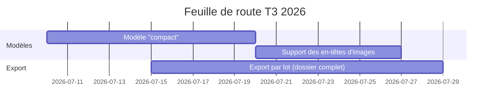
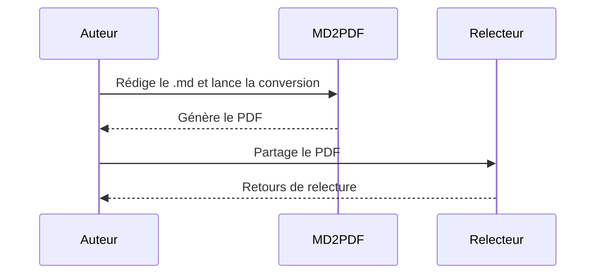

# Synthèse

Ce document illustre le modèle **rapport**, qui ajoute une page de garde
plein format (sans en-tête ni pied de page) suivie de pages de contenu avec
en-tête (titre à gauche, section courante à droite) et une pagination en
pied de page.

Le champ `template: rapport` de l'en-tête du fichier indique explicitement
à l'extension quel modèle utiliser ; sans ce champ, le modèle `default`
aurait été utilisé.

## Périmètre du trimestre

Le tableau ci-dessous résume les indicateurs clés suivis sur la période.

| Indicateur          | T1 2026 | T2 2026 | Évolution |
|----------------------|:-------:|:-------:|:---------:|
| Utilisateurs actifs   | 12 400  | 15 900  | +28 %     |
| Taux de conversion    | 3.1 %   | 3.6 %   | +0.5 pt   |
| Tickets support        | 340     | 275     | -19 %     |

## Feuille de route

## Processus de validation

## Points de vigilance

> La génération du PDF nécessite un moteur Chromium (fourni par Puppeteer).
> En environnement sans accès internet, configurer
> `md2pdf.chromiumExecutablePath` vers un Chrome déjà installé.

## Prochaines étapes

1. Finaliser le modèle "compact" pour les notes internes.
2. Ajouter la prise en charge de logos par équipe.
3. Documenter les modèles personnalisés dans le wiki interne.
