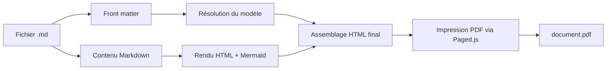

# Introduction

Ce fichier utilise le modèle **par défaut** de l'extension (aucun champ
`template` n'est précisé dans l'en-tête ci-dessus). Ouvre-le dans VS Code puis :

- lance la commande **MD2PDF : Convertir en PDF** depuis la palette de commandes,
- ou utilise le raccourci **Ctrl+Alt+P** (Cmd+Alt+P sur macOS),
- ou clique sur l'icône PDF dans la barre d'outils de l'éditeur.

## Fonctionnalités démontrées ici

1. Extraction des informations d'en-tête (front matter) : `title`, `subtitle`, `author`, `date`.
2. Conversion Markdown standard : **gras**, *italique*, listes, liens.
3. Tableaux.
4. Diagramme Mermaid.js.
5. Pagination avec en-tête et pied de page (numérotation) gérée par Paged.js.

## Tableau comparatif

| Fonctionnalité       | Sans MD2PDF | Avec MD2PDF |
|-----------------------|:------------------:|:-------------------:|
| Export PDF depuis VS Code | ❌ | ✅ |
| Modèles HTML personnalisables | ❌ | ✅ |
| Diagrammes Mermaid rendus | ❌ | ✅ |
| En-têtes / pieds de page CSS | ❌ | ✅ |

## Diagramme d'architecture

## Citation

> Un bon outil de documentation doit rester invisible : on écrit du Markdown,
> et le PDF suit tout seul.

## Conclusion

Essaie maintenant de dupliquer ce fichier et d'ajouter `template: rapport`
dans l'en-tête pour voir le second modèle fourni avec l'extension.
