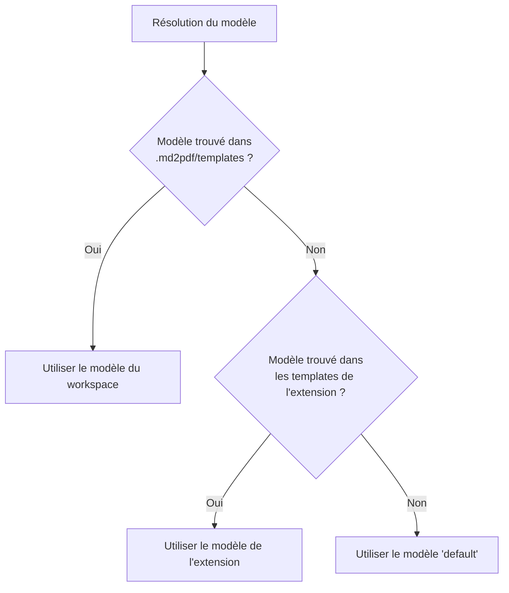

# Contexte

Ce fichier se trouve dans un **workspace** qui définit son propre modèle
personnalisé nommé `compact`, situé dans :

```
.md2pdf/templates/compact/template.html
.md2pdf/templates/compact/style.css
```

Quand la commande de conversion est lancée sur ce fichier, l'extension
recherche d'abord un modèle `compact` dans ce dossier du workspace **avant**
de regarder dans les modèles fournis par l'extension elle-même. C'est ce qui
permet à chaque projet de définir sa propre charte graphique sans toucher au
code de l'extension.

# Détails techniques

Le modèle `compact` utilisé ici réduit les marges et les tailles de police,
pour des notes internes courtes destinées à être imprimées en interne.


